# دليل تثبيت تطبيق DynaOps وتفعيل الأذونات

يشرح هذا الدليل خطوة بخطوة كيفية تثبيت تطبيق **DynaOps** على هاتف أندرويد من ملف APK، وكيفية الموافقة على الأذونات التي يطلبها التطبيق حتى تعمل خدمات الموقع (GPS) والكاميرا والإشعارات على النحو الصحيح.

> **تنبيه مهم:** لن يفتح التطبيق الشاشة الرئيسية إلا بعد الموافقة على جميع الأذونات المطلوبة. وإذا رفضت أحد الأذونات، فسيستمر التطبيق في طلبه وسيوجّهك إلى الإعدادات حتى تفعّله.
> الصور في هذا الدليل مأخوذة من هاتف بواجهة إنجليزية، لذا وُضع اسم كل زر بالإنجليزية بين قوسين بجانب اسمه بالعربية.

---

## المتطلبات قبل البدء

- هاتف يعمل بنظام **أندرويد** (التطبيق غير متاح حاليًا على أجهزة آيفون).
- اتصال بالإنترنت.
- ملف التطبيق **DynaOps.apk** (يصلك من الشركة عبر واتساب أو البريد الإلكتروني أو رابط تنزيل).
- بيانات الدخول (اسم المستخدم وكلمة المرور) من المسؤول لديك.

---

## الجزء الأول: تثبيت التطبيق

### 1. فتح ملف APK

افتح المحادثة أو الرسالة التي تحتوي على ملف التطبيق، واضغط على الملف لتنزيله ثم فتحه.

### 2. تجاوز تحذير الملف

قد يعرض واتساب (أو المتصفح) رسالة تفيد بأن الملف قد يكون ضارًا. هذا أمر طبيعي مع أي تطبيق لا يُنزَّل من متجر Google Play. اضغط **"فتح الملف" (Open file)**.

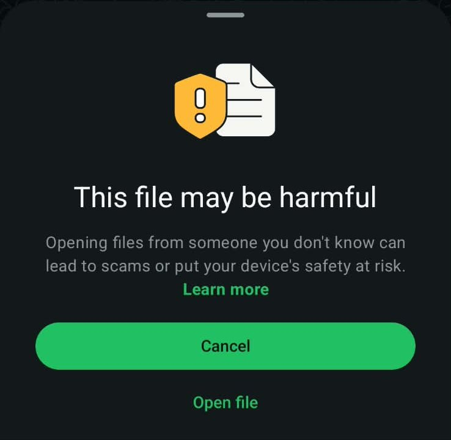

> إذا نزّلت الملف من المتصفح وظهرت رسالة **"قد يكون هذا الملف ضارًا"**، فاضغط **"تنزيل على أي حال"**.

### 3. السماح بتثبيت التطبيقات من مصادر غير معروفة

قد يُعلمك نظام أندرويد عند التثبيت لأول مرة بأن التثبيت من هذا المصدر غير مسموح به. في هذه الحالة:

1. اضغط **"الإعدادات" (Settings)** في الرسالة الظاهرة.
2. فعّل خيار **"السماح من هذا المصدر" (Allow from this source)**.
3. اضغط زر الرجوع، وستظهر لك شاشة التثبيت.

> إذا لم تظهر لك هذه الرسالة، فتجاوز هذه الخطوة.

### 4. تثبيت التطبيق

اضغط **"تثبيت" (Install)**.

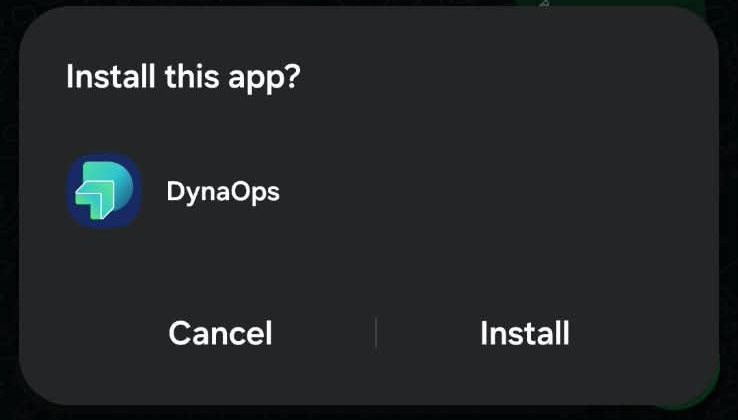

### 5. تجاوز تنبيه Google Play Protect

قد تظهر رسالة من **Google Play Protect** تفيد بأنه لم يسبق له فحص التطبيق:

1. اضغط **"مزيد من التفاصيل" (More details)**.
2. اضغط **"التثبيت بدون فحص" (Install without scanning)**.

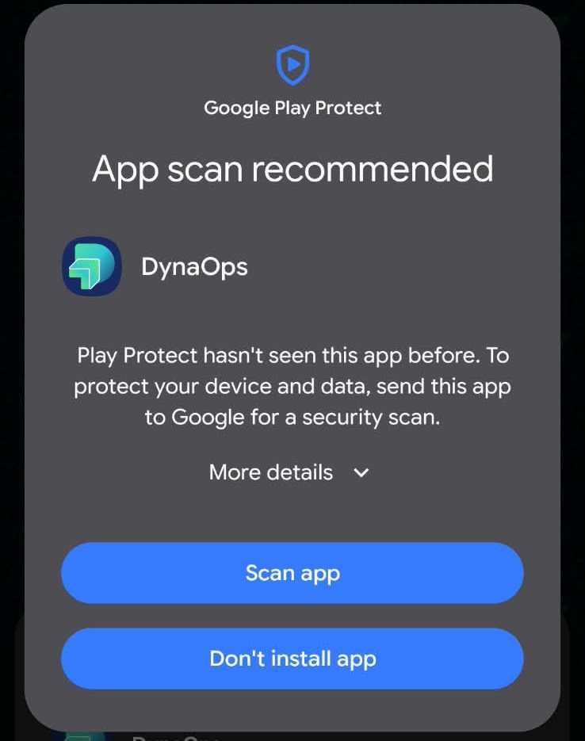 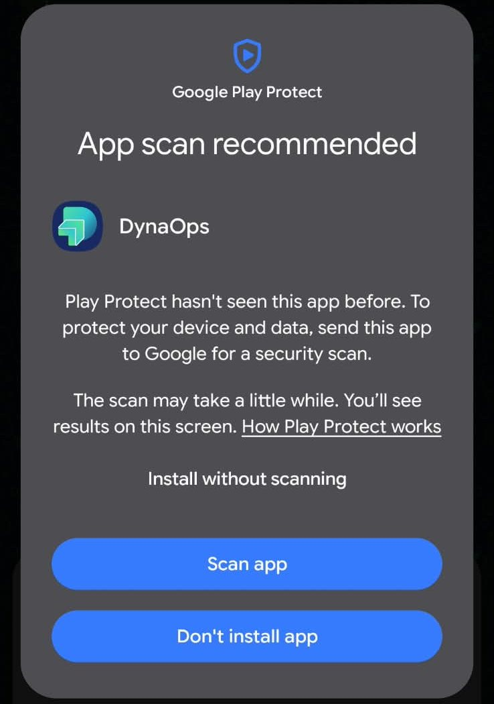

### 6. فتح التطبيق

بعد اكتمال التثبيت اضغط **"فتح" (Open)**. وستجد أيقونة **DynaOps** أيضًا ضمن تطبيقات هاتفك.

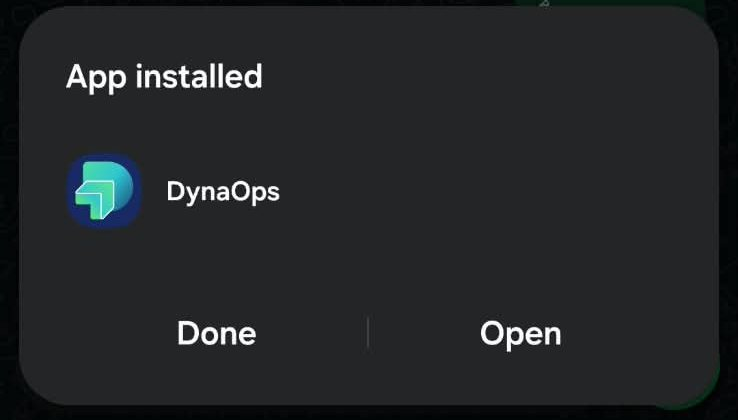 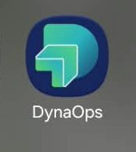

> إذا كانت لديك نسخة سابقة من التطبيق، فسيُحدّثها التثبيت الجديد تلقائيًا دون الحاجة إلى حذفها.

---

## الجزء الثاني: التشغيل الأول وتسجيل الدخول

### إذن الكاميرا

عند فتح التطبيق لأول مرة، ستظهر رسالة تطلب إذن **الكاميرا**. اختر **"أثناء استخدام التطبيق" (While using the app)**.

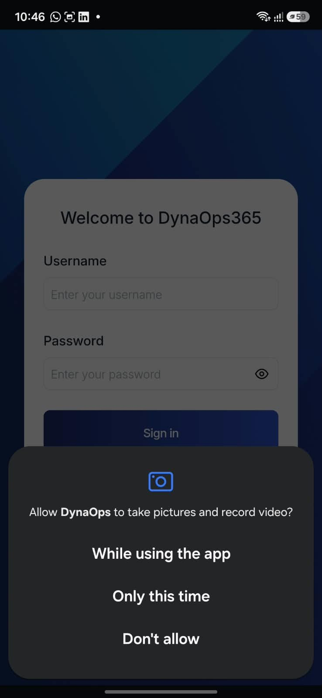

> **السبب:** لتتمكن من التقاط الصور ورفعها مباشرة من داخل التطبيق (مثل صور الزيارات أو المستندات).
> لا تظهر هذه الرسالة إلا **مرة واحدة فقط**. وإذا رفضتها، فستتمكن من رفع الصور من المعرض فقط. راجع قسم "حل المشكلات" أدناه لتفعيلها لاحقًا.

### تسجيل الدخول

أدخل **اسم المستخدم** و**كلمة المرور** اللذين حصلت عليهما من المسؤول، ثم اضغط **"تسجيل الدخول" (Sign in)**. يمكنك تغيير لغة التطبيق من الرابطين **English** و**العربية** أسفل النموذج.

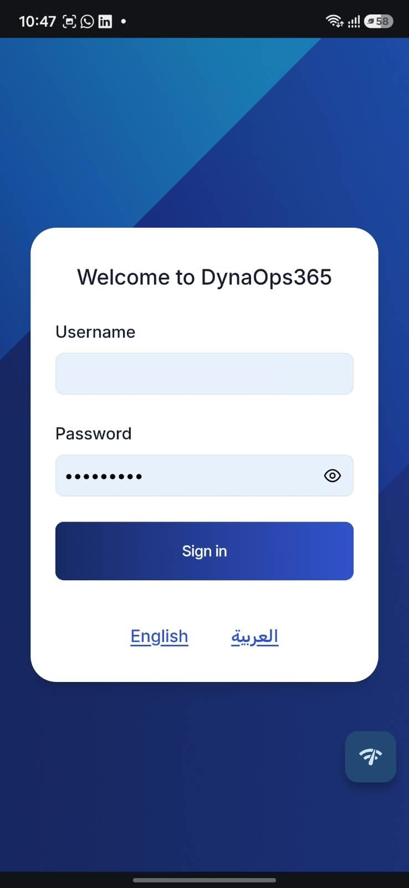

---

## الجزء الثالث: الموافقة على أذونات التتبّع

بعد تسجيل الدخول ستظهر شاشة **"إعداد تتبّع الموقع" (Set up location tracking)**، وفيها خطوات مرقّمة (مثل: "الخطوة 1 من 7"). اتبعها بالترتيب.

> قد يتخطى التطبيق بعض الخطوات تلقائيًا إذا كانت مستوفاة مسبقًا (مثل الخطوة 2 عند اختيار الموقع الدقيق، أو الخطوة 4 إذا كانت خدمة الموقع مفعّلة)، لذا قد تنتقل مثلًا من الخطوة 1 إلى الخطوة 3 مباشرة.

### الخطوة 1: السماح بالموقع

1. اضغط **"سماح" (Allow)**.
2. في الرسالة التي يعرضها نظام أندرويد:
   - تأكد من تحديد **"دقيق" (Precise)** لا "تقريبي" (Approximate).
   - اختر **"أثناء استخدام التطبيق" (While using the app)**.

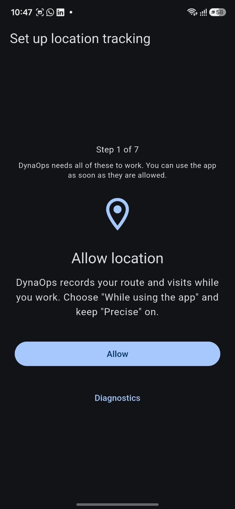 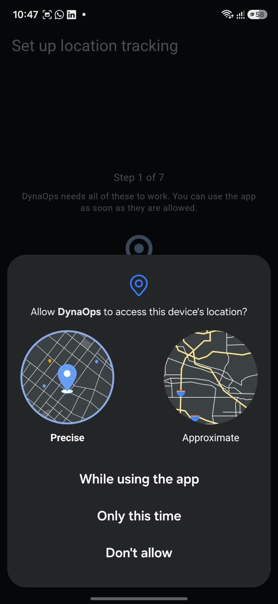

> **السبب:** يسجّل التطبيق مسارك وزياراتك أثناء العمل.

### الخطوة 2: تشغيل الموقع الدقيق

لا تظهر هذه الخطوة إلا إذا اخترت "الموقع التقريبي" عن طريق الخطأ.

1. اضغط **"فتح الإعدادات" (Open settings)**.
2. انتقل إلى **الأذونات ← الموقع**.
3. فعّل **"استخدام الموقع الدقيق" (Use precise location)**.
4. ارجع إلى التطبيق، وسيتابع تلقائيًا.

> قد يبعد الموقع التقريبي كيلومترات عن موقعك الفعلي، ولذلك لا يمكن تسجيل المسار به.

### الخطوة 3: السماح بالموقع طوال الوقت

1. اضغط **"سماح" (Allow)**، وستُفتح لك شاشة إذن الموقع في الإعدادات.
2. اختر **"السماح طوال الوقت" (Allow all the time)**، وتأكد من بقاء **"استخدام الموقع الدقيق"** مفعّلًا.
3. ارجع إلى التطبيق بزر الرجوع.

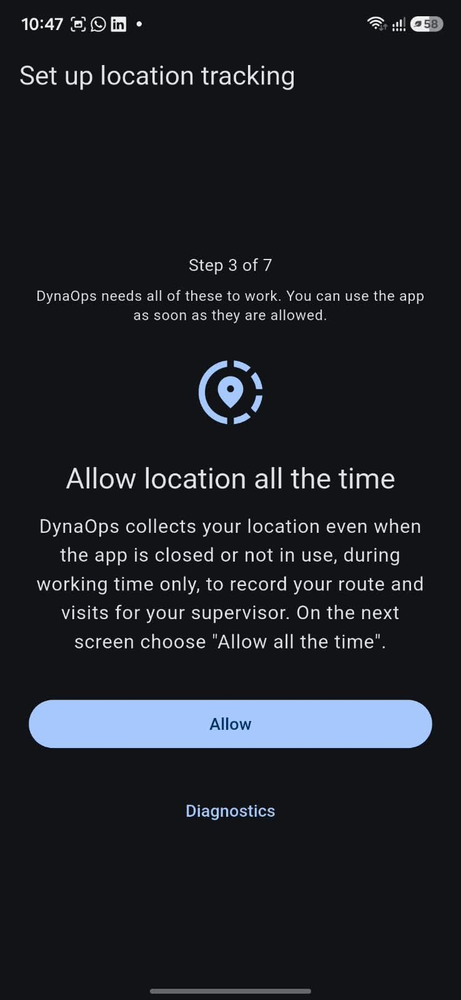 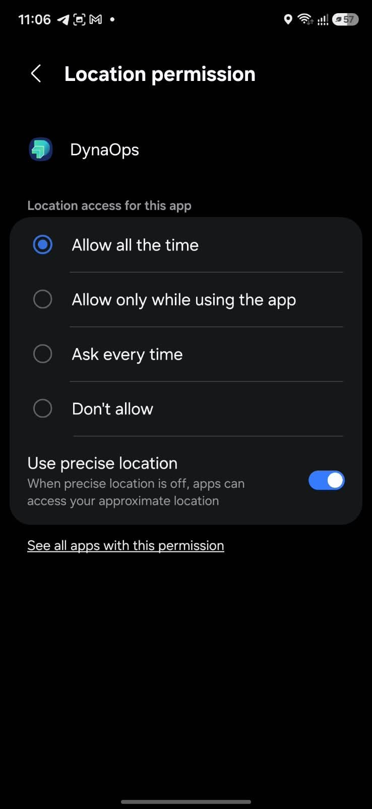

> **السبب:** ليتمكن التطبيق من تسجيل موقعك حتى عند إغلاقه أو قفل الهاتف، وذلك **خلال وقت العمل فقط**.

### الخطوة 4: تشغيل خدمة الموقع (GPS)

تظهر هذه الخطوة إذا كانت خدمة الموقع في الهاتف متوقفة.

1. اضغط **"تشغيل الموقع" (Turn on location)**، وستُفتح شاشة الموقع في الإعدادات.
2. فعّل المفتاح في أعلى الشاشة ليصبح **"تشغيل" (On)**.
3. ارجع إلى التطبيق، وسيتابع تلقائيًا.

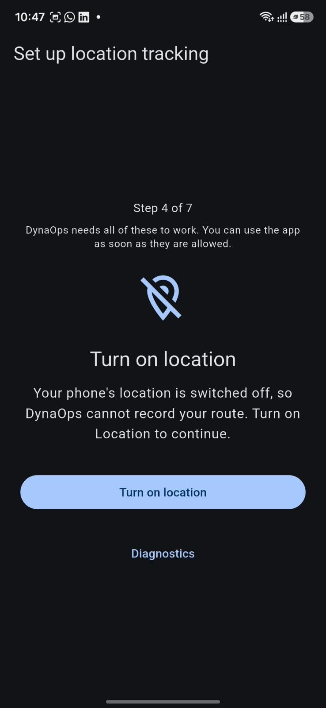 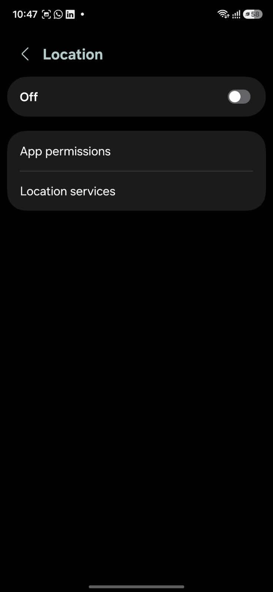

> **مهم:** أبقِ خدمة الموقع مفعّلة طوال وقت العمل. ويمكنك أيضًا تشغيلها بالسحب من أعلى الشاشة والضغط على أيقونة **الموقع**.

### الخطوة 5: السماح بالإشعارات

1. اضغط **"سماح" (Allow)**.
2. في رسالة أندرويد اختر **"سماح" (Allow)**.

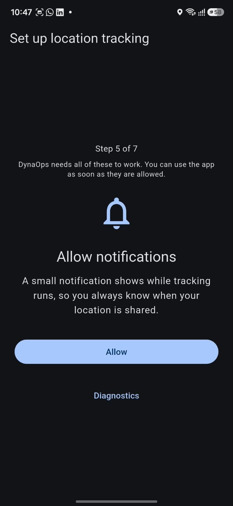 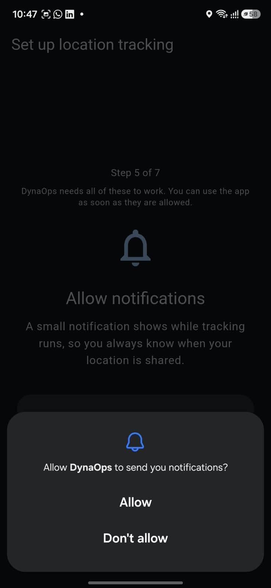

> **السبب:** يظهر إشعار صغير ثابت أثناء التتبّع لتعرف دائمًا متى تتم مشاركة موقعك. **لا تُوقف هذا الإشعار.**

### الخطوة 6: إبقاء DynaOps قيد التشغيل (تحسين البطارية)

1. اضغط **"سماح" (Allow)**.
2. في رسالة **"إيقاف تحسين استخدام البطارية؟" (Stop optimising battery usage?)** اضغط **"موافق" (OK)**.

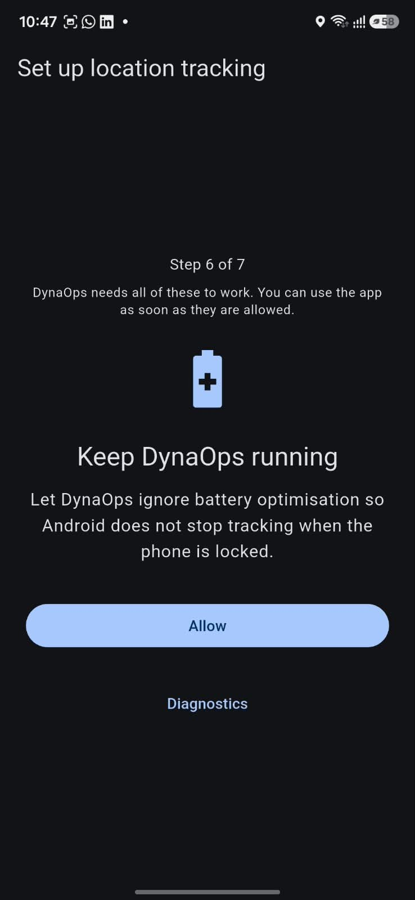 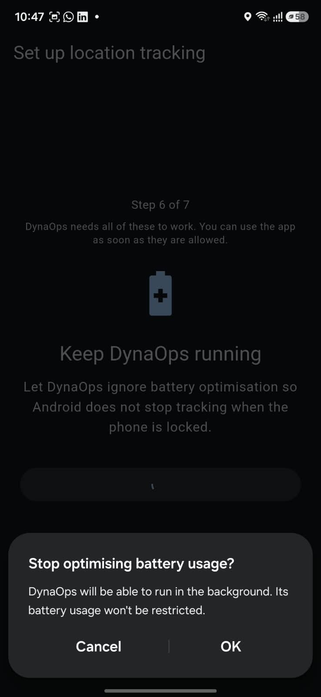

> **السبب:** بدون هذه الخطوة قد يُوقف نظام أندرويد التطبيق عند قفل الهاتف، فينقطع تسجيل المسار.

### الخطوة 7: إعداد إضافي بحسب نوع الهاتف

تظهر هذه الخطوة في بعض أنواع الهواتف التي تُغلق التطبيقات العاملة في الخلفية بصورة مفرطة، ويعرض فيها التطبيق التعليمات المناسبة لهاتفك.

**مثال على هاتف Samsung:**

1. اضغط **"فتح الإعدادات" (Open settings)**، وستُفتح صفحة **معلومات التطبيق (App info)**.
2. اضغط **"البطارية" (Battery)**.
3. اختر **"غير مقيّد" (Unrestricted)**.
4. ارجع إلى التطبيق واضغط **"تم" (Done)**.

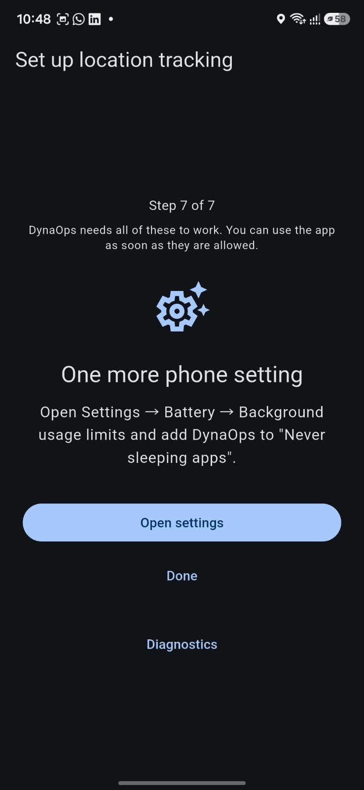 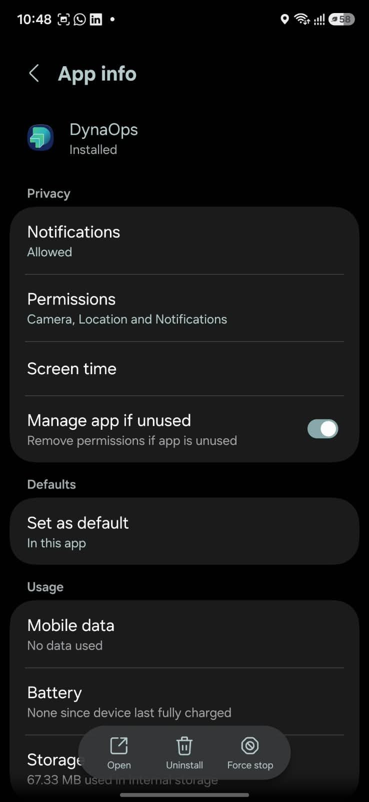 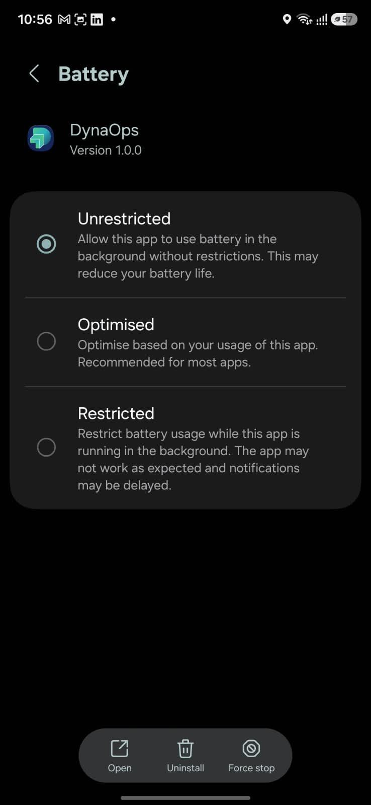

يُستحسن أيضًا في هواتف Samsung فتح **الإعدادات ← البطارية ← حدود الاستخدام في الخلفية** وإضافة DynaOps إلى **"التطبيقات التي لا تدخل في السكون أبدًا" (Never sleeping apps)**.

**باقي أنواع الهواتف:**

| نوع الهاتف | الإعداد المطلوب |
|---|---|
| **Samsung** | الإعدادات ← البطارية ← حدود الاستخدام في الخلفية ← أضف DynaOps إلى **"التطبيقات التي لا تدخل في السكون أبدًا"** |
| **Xiaomi / Redmi / POCO** | افتح إعدادات التطبيق ← فعّل **"التشغيل التلقائي"** ← واضبط **موفّر البطارية** على **"بلا قيود"** |
| **Huawei / Honor** | الإعدادات ← البطارية ← تشغيل التطبيقات ← اختر DynaOps ← **الإدارة اليدوية** مع تفعيل **المفاتيح الثلاثة** |
| **OPPO / Realme / OnePlus** | افتح إعدادات التطبيق ← البطارية ← اسمح بـ **النشاط في الخلفية** و**التشغيل التلقائي** |
| **Vivo / iQOO** | الإعدادات ← البطارية ← استهلاك الطاقة في الخلفية ← اسمح لتطبيق DynaOps **بالعمل في الخلفية** |

> قد تختلف التسميات قليلًا باختلاف إصدار النظام، لكن الهدف واحد: **منع الهاتف من إغلاق DynaOps في الخلفية.**

---

## الانتهاء

بعد إتمام جميع الخطوات، سيفتح التطبيق مساحة العمل الرئيسية، ويمكنك البدء في العمل.

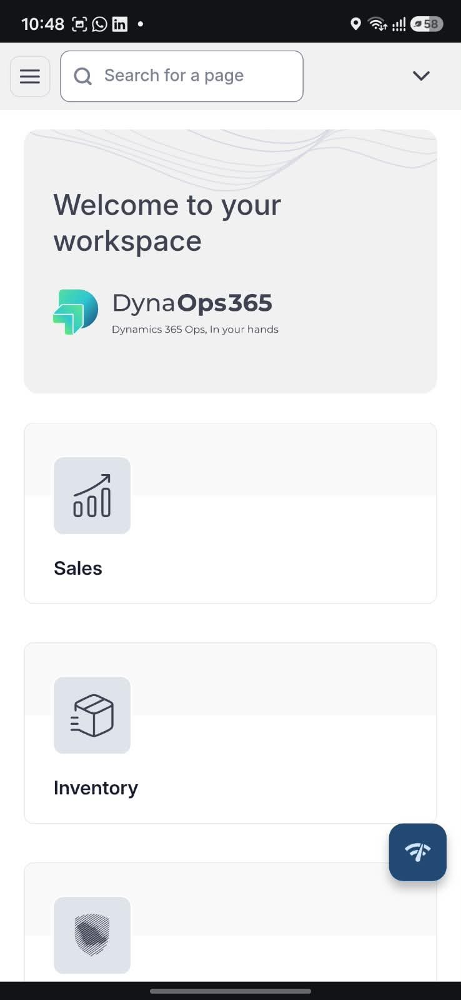

---

## ملخص الأذونات

| الإذن | الاختيار الصحيح | إلزامي؟ | الغرض منه |
|---|---|---|---|
| الكاميرا | أثناء استخدام التطبيق | اختياري | التصوير من داخل التطبيق |
| الموقع | أثناء استخدام التطبيق + **دقيق** | ✅ نعم | تسجيل المسار والزيارات |
| الموقع طوال الوقت | **السماح طوال الوقت** | ✅ نعم | التتبّع أثناء إغلاق التطبيق |
| خدمة الموقع (GPS) | مفعّلة | ✅ نعم | لا يمكن تحديد الموقع بدونها |
| الإشعارات | سماح | ✅ نعم | إشعار التتبّع |
| تجاهل تحسين البطارية | موافق | ✅ نعم | منع أندرويد من إيقاف التطبيق |
| إعداد الشركة المصنّعة | بحسب نوع الهاتف | يُوصى به بشدة | منع إغلاق التطبيق في الخلفية |

---

## حل المشكلات الشائعة

### زر "سماح" لا يستجيب، أو ينقلني إلى الإعدادات مباشرة

يعني ذلك أنك رفضت الإذن سابقًا أكثر من مرة، ولن يعرض نظام أندرويد الطلب مجددًا. اضغط **"فتح الإعدادات"** وفعّل الإذن يدويًا من:
**الأذونات ← (الموقع / الإشعارات)**، ثم ارجع إلى التطبيق.

### أريد تفعيل الكاميرا بعد رفضها

1. اضغط مطولًا على أيقونة **DynaOps** ← **معلومات التطبيق (App info)** (أو: الإعدادات ← التطبيقات ← DynaOps).
2. **الأذونات (Permissions) ← الكاميرا (Camera) ← السماح أثناء استخدام التطبيق**.

### ينقطع المسار أو يتوقف التتبّع عند قفل الهاتف

تأكد مما يلي:
- إذن الموقع مضبوط على **"طوال الوقت"** و**"دقيق"**.
- خدمة الموقع (GPS) مفعّلة.
- تحسين البطارية متجاهَل لهذا التطبيق (الخطوة 6).
- إعداد الشركة المصنّعة الخاص بهاتفك منفّذ (الخطوة 7).
- **وضع توفير الطاقة** متوقف أثناء العمل.
- عدم تنفيذ **"إيقاف إجباري" (Force stop)** للتطبيق، وعدم إزالته من قائمة التطبيقات المفتوحة بشكل متكرر.

### ظهر إشعار "مطلوب إذن الموقع — اضغط لفتح DynaOps"

أُلغي إذن الموقع (قد يُلغيه نظام أندرويد تلقائيًا إذا لم يُستخدم التطبيق مدة من الزمن، عبر خيار **"إدارة التطبيق إذا لم يُستخدم" (Manage app if unused)** في صفحة معلومات التطبيق). اضغط الإشعار، وسينقلك التطبيق إلى الخطوة الناقصة. ولتجنّب تكرار ذلك، أوقف هذا الخيار من صفحة معلومات التطبيق.

### ظهر إشعار "تتبّع الموقع متوقف مؤقتًا" أو "خارج وقت ورديتك"

هذا أمر طبيعي ولا يدل على مشكلة؛ إذ يعمل التتبّع **خلال وقت الوردية فقط**، وسيُستأنف تلقائيًا عند بدايتها.

### تعذّر تثبيت التطبيق، أو ظهرت رسالة "لم يتم تثبيت التطبيق"

- تأكد من توفر مساحة تخزين كافية في الهاتف.
- إذا كانت لديك نسخة سابقة من مصدر مختلف، فاحذفها أولًا ثم ثبّت النسخة الجديدة.
- تأكد من اكتمال تنزيل الملف (أعد تنزيله إن كنت في شك).

---

## الخصوصية

- يجمع التطبيق موقعك **خلال وقت العمل فقط**.
- يظهر الإشعار الثابت **دائمًا** طوال مدة مشاركة موقعك، فتعرف في كل وقت متى يكون التتبّع قيد التشغيل.
- تُرسَل البيانات إلى مشرفك في الشركة فقط لمتابعة المسار والزيارات.

<!-- lang:en -->

# DynaOps Installation and Permissions Guide

This guide explains, step by step, how to install the **DynaOps** app on an Android phone from an APK file, and how to grant the permissions the app requests so that location (GPS), the camera and notifications work correctly.

> **Important:** The app will not open its main screen until all required permissions are granted. If you deny a permission, the app will keep asking for it and direct you to Settings until you enable it.

---

## Before You Start

- A phone running **Android** (the app is not currently available for iPhone).
- An internet connection.
- The app file **DynaOps.apk** (sent to you by the company via WhatsApp, email or a download link).
- Your sign-in details (username and password) from your administrator.

---

## Part 1: Installing the App

### 1. Open the APK file

Open the chat or message containing the app file, then tap the file to download and open it.

### 2. Get past the file warning

WhatsApp (or your browser) may warn that the file could be harmful. This is normal for any app that is not downloaded from the Google Play Store. Tap **Open file**.

> If you downloaded the file in a browser and see **"This file may be harmful"**, tap **Download anyway**.

### 3. Allow installing apps from unknown sources

The first time you install, Android may tell you that installing from this source is not allowed. If so:

1. Tap **Settings** in the message that appears.
2. Turn on **Allow from this source**.
3. Press Back, and the installation screen will appear.

> If you do not see this message, skip this step.

### 4. Install the app

Tap **Install**.

### 5. Get past the Google Play Protect warning

**Google Play Protect** may show a message saying it has not scanned this app before:

1. Tap **More details**.
2. Tap **Install without scanning**.

 

### 6. Open the app

When installation finishes, tap **Open**. You will also find the **DynaOps** icon among your phone's apps.

 

> If you already have an older version of the app, the new installation updates it automatically; there is no need to uninstall it first.

---

## Part 2: First Launch and Sign-in

### Camera permission

The first time you open the app, a message asks for **camera** permission. Choose **While using the app**.

> **Why:** So you can take photos and upload them directly from inside the app (such as visit photos or documents).
> This message appears **only once**. If you deny it, you will only be able to upload photos from your gallery. See "Troubleshooting" below to enable it later.

### Sign in

Enter the **username** and **password** you received from your administrator, then tap **Sign in**. You can switch the app's language using the **English** and **العربية** links below the form.

---

## Part 3: Granting Tracking Permissions

After signing in, the **Set up location tracking** screen appears, with numbered steps (for example, "Step 1 of 7"). Follow them in order.

> The app may skip some steps automatically if they are already satisfied (for example, Step 2 if you chose precise location, or Step 4 if location is already on), so you may go straight from Step 1 to Step 3, for example.

### Step 1: Allow location

1. Tap **Allow**.
2. In the message Android shows:
   - Make sure **Precise** is selected, not "Approximate".
   - Choose **While using the app**.

 

> **Why:** The app records your route and visits while you work.

### Step 2: Turn on precise location

This step only appears if you chose "Approximate" location by mistake.

1. Tap **Open settings**.
2. Go to **Permissions → Location**.
3. Turn on **Use precise location**.
4. Return to the app; it continues automatically.

> Approximate location can be kilometres away from where you actually are, so a route cannot be recorded with it.

### Step 3: Allow location all the time

1. Tap **Allow**; the location permission screen opens in Settings.
2. Choose **Allow all the time**, and make sure **Use precise location** stays on.
3. Press Back to return to the app.

 

> **Why:** So the app can record your location even when it is closed or the phone is locked, **during working time only**.

### Step 4: Turn on location (GPS)

This step appears if location is switched off on the phone.

1. Tap **Turn on location**; the Location screen opens in Settings.
2. Turn on the switch at the top so it shows **On**.
3. Return to the app; it continues automatically.

 

> **Important:** Keep location on throughout working time. You can also turn it on by swiping down from the top of the screen and tapping the **Location** icon.

### Step 5: Allow notifications

1. Tap **Allow**.
2. In Android's message, choose **Allow**.

 

> **Why:** A small persistent notification shows while tracking runs, so you always know when your location is shared. **Do not turn this notification off.**

### Step 6: Keep DynaOps running (battery optimisation)

1. Tap **Allow**.
2. In the **Stop optimising battery usage?** message, tap **OK**.

 

> **Why:** Without this step, Android may stop the app when the phone is locked, and route recording will be interrupted.

### Step 7: Extra setting for your phone brand

This step appears on some phone brands that aggressively close apps running in the background. The app shows the instructions for your phone.

**Example on a Samsung phone:**

1. Tap **Open settings**; the **App info** page opens.
2. Tap **Battery**.
3. Choose **Unrestricted**.
4. Return to the app and tap **Done**.

  

On Samsung phones it is also recommended to open **Settings → Battery → Background usage limits** and add DynaOps to **Never sleeping apps**.

**Other phone brands:**

| Phone brand | Required setting |
|---|---|
| **Samsung** | Settings → Battery → Background usage limits → add DynaOps to **Never sleeping apps** |
| **Xiaomi / Redmi / POCO** | Open the app's settings → turn on **Autostart** → set **Battery saver** to **No restrictions** |
| **Huawei / Honor** | Settings → Battery → App launch → choose DynaOps → **Manage manually** and turn on **all three switches** |
| **OPPO / Realme / OnePlus** | Open the app's settings → Battery → allow **Background activity** and **Auto launch** |
| **Vivo / iQOO** | Settings → Battery → Background power consumption → allow DynaOps **to run in the background** |

> Names may differ slightly between system versions, but the goal is the same: **stop the phone from closing DynaOps in the background.**

---

## All Done

After completing all the steps, the app opens the main workspace and you can start working.

---

## Permissions Summary

| Permission | Correct choice | Required? | Purpose |
|---|---|---|---|
| Camera | While using the app | Optional | Taking photos inside the app |
| Location | While using the app + **Precise** | ✅ Yes | Recording route and visits |
| Location all the time | **Allow all the time** | ✅ Yes | Tracking while the app is closed |
| Location service (GPS) | On | ✅ Yes | No location without it |
| Notifications | Allow | ✅ Yes | Tracking notification |
| Ignore battery optimisation | OK | ✅ Yes | Stops Android from killing the app |
| Phone-brand setting | Depends on the phone | Strongly recommended | Stops the app being closed in the background |

---

## Troubleshooting

### The "Allow" button does nothing, or takes me straight to Settings

This means you denied the permission more than once before, and Android will not ask again. Tap **Open settings** and enable the permission manually under:
**Permissions → (Location / Notifications)**, then return to the app.

### I want to enable the camera after denying it

1. Long-press the **DynaOps** icon → **App info** (or: Settings → Apps → DynaOps).
2. **Permissions → Camera → Allow only while using the app**.

### The route breaks or tracking stops when the phone is locked

Check that:
- Location permission is set to **Allow all the time** and **Precise**.
- Location (GPS) is on.
- Battery optimisation is ignored for the app (Step 6).
- Your phone brand's setting is done (Step 7).
- **Power saving mode** is off during work.
- You do not **Force stop** the app or keep swiping it away from the recent apps list.

### The notification "Location permission needed — tap to open DynaOps" appeared

The location permission was removed (Android can remove it automatically if the app is not used for a while, through the **Manage app if unused** option on the App info page). Tap the notification and the app will take you to the missing step. To prevent this from happening again, turn that option off on the App info page.

### The notification "Location tracking is paused" or "Outside your shift" appeared

This is normal and not a problem: tracking only runs **during your shift**, and resumes automatically when it starts.

### The app will not install, or "App not installed" appears

- Make sure the phone has enough free storage.
- If you have an older version from a different source, uninstall it first, then install the new one.
- Make sure the file downloaded completely (download it again if in doubt).

---

## Privacy

- The app collects your location **during working time only**.
- The persistent notification is **always** shown while your location is being shared, so you always know when tracking is running.
- The data is sent only to your supervisor at the company, to follow your route and visits.
