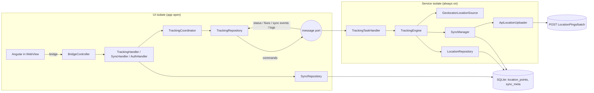

# M2 — Background Tracking: What Was Built

Milestone M2 of the [WebView / offline tracking plan](webview-offline-tracking-checklist.md) (§19). This document records exactly what was implemented, where it lives, how the pieces work together, and what is still open.

| | |
|---|---|
| Date | 2026-10-06 |
| Flutter repo | `dynaopsapp`, branch `m1-shell` (M1 + M2, not committed) |
| Angular repo | `DynaOps365`, branch `flutter-shell` (not committed) |
| Status | Code complete. Unit-tested, builds, runs on the emulator. **Field test not done yet.** |

---

## 1. What M2 delivers

From a rep's point of view:

1. The rep signs in on the Angular login page inside the app. Tracking starts by itself, with no Start button (D8).
2. A persistent notification ("Sharing your location while you work") shows while tracking runs. Its text follows the language the rep chose in Angular.
3. Tracking keeps running when the phone is locked, when the app is in the background, and when it is swiped away from Recents. It comes back after a reboot.
4. Every GPS point is saved on the phone first. Points are uploaded in batches when there is a connection. Offline, they wait on the phone and nothing is lost.
5. Tracking stops only on a deliberate sign-out, or when an admin turns tracking off for the rep. The rep cannot switch it off from the app.
6. If location permission is missing, a native walkthrough explains and asks for each permission in turn: location, "all the time", notifications, battery, and a phone-maker hint.
7. The Angular journey screen shows a tracking status chip, the number of points waiting to upload, an offline banner, and a "Fix tracking permissions" button.
8. Check-in, the geofence and day start use the shell's GPS fix instead of the browser's.
9. Support can open a hidden diagnostics screen with the queue state, the service state and a log they can share.

---

## 2. Architecture

The tracking work runs in **two Dart isolates**:

- **UI isolate:** the normal app — WebView, bridge, Cubits and screens.
- **Service isolate:** started by `flutter_foreground_task`. It keeps running without any UI and starts on its own after a reboot.

Both isolates open the same SQLite file (WAL mode) and talk through `flutter_foreground_task`'s message port.



**Who does what:**

| Concern | Owner | Isolate |
|---|---|---|
| Decide whether to collect (policy, permission, GPS on/off) | `TrackingEngine` | service |
| Collect, filter and store fixes | `TrackingEngine` + `FixFilter` + `LocationRepository` | service |
| Upload | `SyncManager` | service (UI only while the service is stopped) |
| Start/stop the service; session rules (§7) | `TrackingRepository` + `TrackingCoordinator` | UI |
| Bridge actions and events | handlers | UI |
| Native screens | Cubits + screens | UI |

The layering follows the project skills. Plugins live only in the data layer, and Cubits depend only on repositories. Code that must run without a screen is written as an **engine** (`engine/` folders), not as a Cubit.

---

## 3. Flutter — files and responsibilities

### 3.1 Storage

| File | What it does |
|---|---|
| `core/database/app_database.dart` | Opens `dynaops.db` (WAL) and applies an ordered list of migrations, using SQLite `user_version` as the schema version. v1 creates `location_points` (index on `user_id, state, captured_at`) and `sync_meta`. |
| `features/tracking/data/location_points_dao.dart` | All SQL for the points store: `insert` (duplicate ids ignored), `claimBatch` (atomic: pending → uploading under a batch id), `markSynced`, `releaseBatch` (back to pending, counts an attempt, dead-letters after the max), `failBatch` (retryable or not), `resetUploading` (crash recovery), `requeueFailed`, `deleteSynced` (after each accepted batch; keeps the user's newest row), `queued`, `counts`, `latest`. **Every query is scoped to one `userId`.** |
| `features/sync/data/sync_meta_dao.dart` | Key/value rows shared by both isolates: last upload, last error, policy snapshot, policy fetch time, service-running flag. Used instead of `shared_preferences`, which caches separately in each isolate. |

**Row states:** `pending → uploading → synced`. A row can also go `uploading → pending` (transient failure) or `uploading → failed` (rejected, or too many attempts).

**Retention (§9):** no location history is kept on the phone. Right after each accepted batch, `SyncManager` deletes the user's `synced` rows except their newest row, which `tracking.latest` may still answer from. Because that delete covers every `synced` row of the user, rows left behind by a crash between "mark synced" and "delete" go with the next accepted batch, so there is no separate daily cleanup. Rows that are `pending` or `failed` are never deleted automatically.

### 3.2 Tracking data layer

| File | What it does |
|---|---|
| `position_model.dart` | One raw reading: lat/lng, accuracy, UTC time, speed (m/s), heading, mock flag. Keeps `geolocator` types out of the rest of the code. |
| `location_fix_model.dart` | A stored fix: id (uuid), `userId`, position, state, attempts. Maps to/from database rows and isolate messages, to the `tracking.location` JSON, and to the upload ping (`toWirePing`). |
| `tracking_policy_model.dart` | `trackingEnabled`, `trackingMode`, `shiftWindow { workingDays (0 = Sunday), availableHoursPerDay, dailyStartTime "HH:mm" }`, exactly as `GET RepDashboard` returns them. |
| `tracking_status_model.dart` | State machine snapshot. States: `stopped`, `starting`, `running`, `stopping`, `permission_required`, `permission_denied`, `error`. Reasons: `signedOut`, `disabledByAdmin`, `outsideShift`, `sessionExpired`. Error codes: `LOCATION_DISABLED`, `LOCATION_UNAVAILABLE`, `FORCE_STOPPED_PREVIOUSLY`, `SERVICE_START_FAILED`. |
| `location_source.dart` | `LocationSource` interface (swappable, D3) and `GeolocatorLocationSource`: high-accuracy stream at the configured interval, one-shot fix, GPS on/off stream, permission check. Plugin errors become `PermissionFailure` / `LocationFailure`. |
| `tracking_api.dart` | Raw `GET RepDashboard`; returns the envelope's `data`. |
| `tracking_policy_repository.dart` | Policy snapshot in `sync_meta` (works offline), refreshed from the API when stale (1 h) or on demand. With no snapshot it falls back to the server's own default: enabled, Route mode. |
| `location_repository.dart` | Store-first writes, counts, and `latestFix()` for `tracking.latest`: a stored fix if it is younger than `maxAge`, otherwise a fresh reading (15 s limit; Angular waits 20 s). |
| `tracking_service_client.dart` | The UI isolate's wrapper around `flutter_foreground_task`. The service has type `location`, uses `stopWithTask=false`, restarts on boot and after an app update, and ticks every `HEARTBEAT_SECONDS` (30 s). |
| `tracking_repository.dart` | UI side: starts the service only when foreground location is granted and a session exists, forwards commands, keeps the latest status (from the service, or computed locally while it is stopped), relays fixes, `stopAndFlush()`, and detects a previous Force Stop. |

### 3.3 Tracking engine (service isolate)

| File | What it does |
|---|---|
| `engine/tracking_task_handler.dart` | `startTrackingTask()` entry point. It builds the service isolate's own locator, starts the engine, forwards ticks and commands (commands that arrive during startup are queued), and opens the app when the notification is tapped. |
| `core/di/task_locator.dart` | `setupTaskLocator()`: the service isolate's own `get_it` graph (no Cubits, no analytics). |
| `engine/tracking_engine.dart` | The state machine (details below). |
| `engine/tracking_policy.dart` | Pure auto-start rule (D8). |
| `engine/fix_filter.dart` | Cleans fixes before storage. |
| `engine/foreground_task_port.dart` | `TrackingPort`: publish status, fixes, sync events and logs to the UI; update the notification (localised with `lookupAppLocalizations`); stop the service. |
| `engine/task_protocol.dart` | Names of commands (UI → service) and messages (service → UI). |

**Auto-start rule (`TrackingPolicy.decide`):**

1. No session → stop (`signedOut`); the service shuts itself down.
2. `trackingEnabled = false` → stop (`disabledByAdmin`); the service shuts itself down. It is re-checked the next time the app opens or resumes.
3. Shift mode with a window → collect only inside `[start, start + hours)` in device-local time, on the working day the shift **started**. Yesterday's shift is checked too, so midnight-crossing shifts work. Outside the window → stopped (`outsideShift`), and the service stays alive so it can resume when the window opens.
4. Anything else (Continuous, Route, Shift with no calendar) → collect.

An **expired token does not stop collection** (D6). `userId` is kept, the state stays `starting`/`running` with reason `sessionExpired`, and uploads pause.

**Engine loop:**

- **Start:** mark the service as running, load the session, recover rows stuck in `uploading`, refresh the policy if stale, watch GPS on/off and the network, evaluate, then try a sync.
- **Evaluate:** apply the rule → check foreground location permission (`permission_required` / `permission_denied`) → check GPS is on (`error` + `LOCATION_DISABLED`) → make sure the position stream runs → publish the status and update the notification when it changes.
- **Each GPS sample (every 1 s, `GPS_SAMPLE_SECONDS`):** filter → `PingSampler`. By default no sample becomes a ping except the first one after (re)start; pings come from the heartbeat, so **one point every 30 s**. Setting `DISTANCE_FILTER_M` (e.g. 25, the old tracker's rule) also makes a ping of any sample that moved that far since the last one. A ping is **stored first** → published as `tracking.location` → state `running` → a sync is triggered if ≥ one batch (100) is pending.
- **Every heartbeat tick (30 s, `HEARTBEAT_SECONDS`):**
  - Watchdog: no fix for 5 min → restart the stream once; still nothing → `error` + `LOCATION_UNAVAILABLE`.
  - Heartbeat ping: the newest sample, if it is under 15 s old and no ping went out in the last 15 s.
  - Refresh the policy hourly and re-evaluate (shift edges, a revoked or re-granted permission).
  - Publish the pending count, last fix and last upload.
  - Trigger a sync.
- **Commands from the UI:** `sessionChanged`, `syncNow`, `refreshPolicy`, `permissionsChanged`, `publishStatus`, `flush`. `flush` stops collecting, runs one upload cycle and replies with the number uploaded; it is used for sign-out and user swap.

**Fix filter:**

- Drops fixes with accuracy worse than 100 m.
- Drops duplicate or out-of-order timestamps.
- Drops jumps implying more than 70 m/s (about 250 km/h).
- Counts every rejection by reason.
- Never invents a speed.

**Ping speed (`PingSampler`):** measured over the window since the previous ping, not taken from one instant reading. It is the larger of the mean Doppler speed of the window's samples and the path length ÷ window time; the path only grows by steps larger than max(10 m, fix accuracy). Below 0.5 m/s it is reported as 0 (GPS drift while parked). Heading is the receiver's course when it reads ≥ 1 m/s, else the bearing from the previous ping. This fixes the old tracker's zero speeds: an instant reading of 0 at a light or turn, Android fixes with `speed = 0` and no Doppler solution, and parked drift.

### 3.4 Sync

| File | What it does |
|---|---|
| `sync/data/location_upload_api.dart` | Raw `POST LocationPings/batch`. |
| `sync/data/location_uploader.dart` | `LocationUploader` interface + `ApiLocationUploader`; maps every error to a `Failure`. |
| `sync/engine/sync_manager.dart` | One cycle at a time (details below). |
| `sync/engine/backoff.dart` | 5 s, 10 s, 20 s … capped at 15 min, ±20 % jitter. |
| `sync/data/sync_repository.dart` | UI side: `sync.status` numbers, `sync.now`, `sync.retryFailed`, one stream of `sync.*` events (from the service, or from a local manager that runs only while the service is stopped), and a bounded `flushLocal()` for sign-out. |
| `sync/data/sync_status_model.dart` | `SyncStatusModel` + `SyncCycleResult`. |

**One sync cycle (`SyncManager.runCycle`):**

- **Skips** when: another cycle is running; signed out; the session has expired; inside the backoff window (unless it is a manual run); offline; nothing pending.
- **Loop:** claim the oldest 100 pending fixes of the **current user** → upload → handle the result:

| Server result | What happens |
|---|---|
| 2xx | rows `synced`, then deleted (all but the user's newest row); reset the backoff; save `last_success_at` |
| 400 / 413 / 422 | rows `failed`, not retryable; continue with the next batch |
| 401 | rows back to `pending` (no attempt counted); session marked expired; stop |
| 403 | rows `failed` but retryable (`sync.retryFailed` brings them back); stop |
| network / timeout / 5xx | rows back to `pending` (+1 attempt, dead-lettered after 10); back off; stop |

- **Events:** `sync.started {total}`, `sync.progress {processed,total,failed}`, `sync.completed {…}`, `sync.failed {code,message}`.
- **Two isolates can't upload the same rows.** `claimBatch` is a transaction that marks rows `uploading` under a unique batch id and returns only those rows.

### 3.5 Session rules — `engine/tracking_coordinator.dart` (UI isolate)

| Event | What happens |
|---|---|
| App launch | Report a Force Stop if the last run did not shut down cleanly; if a session exists, start tracking. |
| `auth.setSession`, same user | Adopt (no-op if identical) → make sure the service runs. |
| `auth.setSession`, **different user** (§7.1) | Stop and flush the previous user's fixes **with their own token** → forget their policy → adopt the new session → start. The previous user's unsent rows stay attributed to them. |
| `auth.signOut{deliberate:true}` | Stop collecting → flush (≤ 20 s) → clear the session → return the uploaded count. |
| 401 / token expiry | Token dropped, `userId` kept; the service re-reads the session; collection continues; uploads pause. No "sign in to resume uploads" message is shown (removed 2026-10-07); the notification keeps its normal text. |
| Location permission re-granted | Restart tracking automatically. |
| App resumed | Refresh the policy and status if the service runs; otherwise try to start it. |

### 3.6 Bridge

New or changed handlers in `lib/bridge/handlers/`:

| Action | Behaviour |
|---|---|
| `tracking.start` | Retries through the coordinator, e.g. after a permission fix; returns `{state}`. |
| `tracking.stop` | **Refused with `UNSUPPORTED` while a session exists** (D8). |
| `tracking.status` | Full `TrackingStatusModel` JSON. |
| `tracking.latest` | `{maxAgeSeconds = 30, highAccuracy = true}` → `{latitude, longitude, accuracy, speed, heading, timestamp, source: cache\|fresh}`. Errors: `PERMISSION_REQUIRED`, `LOCATION_DISABLED`, `LOCATION_UNAVAILABLE`. |
| `tracking.refreshPolicy` | Re-reads `RepDashboard` and returns `{enabled, mode, shiftWindow}`. |
| `sync.status` / `sync.now` / `sync.retryFailed` | `{running, pending, failed, lastSuccessAt, lastError}` / `{started}` / `{requeued}`. |
| `app.openNativeScreen` | `{screen: permissions\|diagnostics}` opens the native screen. |
| `auth.setSession` / `auth.signOut` | Now go through `TrackingCoordinator`; `signOut` returns the real `flushed` count. |

Events: `tracking.statusChanged`, `tracking.location`, `sync.started | progress | completed | failed`; `app.resumed` now carries the real `trackingState` and `pendingCount`.

`bridge_handler.dart` gained `mergeEvents()`, a real stream merge used by `BridgeController` and `TrackingHandler`, and `optionalNum()` for payloads.

### 3.7 Native screens

| Route | Cubit | Screen |
|---|---|---|
| `/permissions` | `PermissionsCubit` | `PermissionWalkthroughScreen` + `PermissionStepCard` |
| `/diagnostics` | `DiagnosticsCubit` | `DiagnosticsScreen` + `DiagnosticsSection` |
| `/` (shell) | adds `TrackingCubit`, `NativeNavigationCubit` | `ShellScreen` listens to both and navigates |

**Walkthrough (§13):**

- **Steps:** location → background location (with the Play-Store disclosure text) → notifications → battery exemption → maker-specific hint (Samsung, Xiaomi/Redmi/POCO, Huawei/Honor, Oppo/Realme/OnePlus, Vivo/iQOO; skipped on stock phones).
- **Behaviour:**
  - Steps already granted are skipped.
  - A permanently denied permission shows "Open settings" instead of asking again.
  - The step is re-checked when the rep comes back from Settings.
  - When the walkthrough finishes, completion is recorded and tracking restarts.
- **When it opens automatically** (`TrackingCubit`): when tracking reports `permission_required` / `permission_denied`, or on first use after login while "all the time" location is not granted. At most once per app session; never when signed out.

**Diagnostics:**

- **Shows:**
  - tracking state, reason, error and permissions;
  - service on/off, last fix;
  - pending/failed counts, last upload, last error;
  - policy;
  - device info;
  - the last 200 log lines (UI and service, in one buffer).
- **Actions:** Upload now, Retry failed, Share log (`.txt` via the share sheet), Clear web cache (keeps the sign-in).
- **Reached from:** the walkthrough footer, or `app.openNativeScreen({screen:'diagnostics'})`.

### 3.8 Other Flutter changes

- **`core/config/app_config.dart`:** new defines: `PING_TIMESTAMPS` (`local` default / `utc`), `GPS_SAMPLE_SECONDS` (1), `HEARTBEAT_SECONDS` (30), `DISTANCE_FILTER_M` (0 = off), `UPLOAD_BATCH_SIZE` (100).
- **`core/logging/app_logger.dart`:**
  - `onLine` forwards each service log line to the UI.
  - `external()` records those lines on the UI side.
- **`features/auth/data/session_repository.dart`:** `load()` now clears the in-memory session when storage is empty, so the service sees a sign-out.
- **`features/connectivity/data/connectivity_repository.dart`:** a slow reply (receive timeout) now counts as **reachable** (bug found on the real server, §6).
- **`features/files/data/files_repository.dart`:** `shareText()` for the log export.
- **`features/permissions/data/permissions_repository.dart`:** "walkthrough completed" flag.
- **New `features/shell/data/`:** `native_navigation_repository.dart`, `web_cache_repository.dart`.
- **`main.dart`:** opens the service message port, then starts `TrackingCoordinator` (not awaited, so the first frame is not delayed).
- **`l10n`:** about 70 new strings (en + ar), with a proper Arabic plural for "points queued again":
  - notification texts and channel;
  - walkthrough steps and maker hints;
  - diagnostics labels and snackbars.

### 3.9 Android

`AndroidManifest.xml` adds:
- **Permissions:** `ACCESS_BACKGROUND_LOCATION`, `FOREGROUND_SERVICE`, `FOREGROUND_SERVICE_LOCATION`, `POST_NOTIFICATIONS`, `WAKE_LOCK`, `RECEIVE_BOOT_COMPLETED`, `REQUEST_IGNORE_BATTERY_OPTIMIZATIONS`.
- **The service:** `com.pravera.flutter_foreground_task.service.ForegroundService` with `foregroundServiceType="location"` and `stopWithTask="false"`.

### 3.10 New packages

| Package | Version | Use |
|---|---|---|
| `flutter_foreground_task` | ^11.0.3 | the tracking service, boot restart, isolate messaging |
| `geolocator` | ^14.0.1 | position stream, one-shot fix, GPS on/off |
| `sqflite` | ^2.4.4+1 | points store and sync meta |
| `sqflite_common_ffi` (dev) | ^2.4.3 | real SQLite in unit tests |

All three build with AGP 9.1 / compileSdk 37; no new pins or patches were needed.

---

## 4. Upload contract (D5)

The Angular repo has no upload contract: the old tracker app (dyn_gis) posted fixes. The contract was **read from its code**, because it posts to the same API. Only the contract is reused; the new app does not depend on that app.

```http
POST {API_BASE_URL}LocationPings/batch
Authorization: bearer <token>          ← identifies the rep; no identity in the body
Content-Type: application/json

{ "pings": [
  { "at": "2026-10-06T09:59:03",       ← naive, device-local time, no ms, no offset
    "lat": 24.7136, "lng": 46.6753,
    "speedKmh": 28,                     ← integer (m/s × 3.6), server binds to int
    "headingDeg": 182,                  ← integer
    "source": "Gps" }                   ← always "Gps"; unknown values fail the batch
] }
```

- **Responses:** 2xx accepted; 401 token refused; 400 / 413 / 422 never accepted; anything else is retried.
- **Timestamps:** set `PING_TIMESTAMPS=utc` if stored pings come back shifted by whole hours.
- **No dedupe key.** If a request times out after the server already stored the batch, the retry stores those points twice. Fixing this needs an idempotency field from the backend (open item).

**Policy source:** `GET {API_BASE_URL}RepDashboard`. `trackingEnabled`, `trackingMode` and `shiftWindow` sit at the top level of `data`. There is no lighter endpoint for a rep, and the admin `RepTracking` list needs a permission reps don't have.

---

## 5. Angular changes (`DynaOps365`, branch `flutter-shell`)

Everything new runs **only inside the shell**. In the browser/PWA nothing changes, and the old tracker files (`tracker-link.ts`, `handoff.ts`) are untouched.

| File | Change |
|---|---|
| `core/native/native-bridge.contract.ts` | v1.0 contract aligned with the Flutter side: `TrackingStatus`, `TrackingState` (7 values), reasons, error codes, `TrackingLocation`, `SyncProgress`, `TrackingPolicy` (reuses `ShiftWindow` / `TrackingMode` from `tracking.model.ts`). `device.*` is removed; `data.*` stays reserved. |
| `core/native/native-tracking.service.ts` (new) | Signals: `trackingStatus`, `syncStatus`, `online`, `pending`, `needsPermissionFix`, `sessionExpired`. Re-reads status on ready, `app.resumed`, sync and auth events. Methods: `fixPermissions()` (request location / background / notifications → open settings if location or background is permanently denied → `tracking.start({reason:'retryAfterPermission'})`), `syncNow()`, `retryFailed()`. |
| `shared/services/device-location.service.ts` | In the shell, calls `tracking.latest` (maxAge 60 s, 20 s timeout). On `UNSUPPORTED` it falls back to the browser API. Error mapping: permission → `denied`; the rest → `unavailable`. The result shape is unchanged, so `VisitExecutionService` and the capture screen need no change. |
| `feature-pages/field-sales/services/day-stamps.service.ts` | `deviceStartRequest()`: start-day sends `latitude`/`longitude` from the shell fix. `from` is left empty because it is a place name. Without a fix it sends `{}` and the day still starts. |
| `rep-journey/components/native-tracking-strip/` (new) | Pending badge, "Fix tracking permissions", offline banner. No stop control. (The status chip and the "sign in to resume uploads" note were removed on 2026-10-07.) |
| `rep-journey.component.ts/.html` | Shows the strip only in the shell; reloads journey and dashboard on `app.resumed`; start-day fetches the fix first (guarded against a double press). |
| `assets/i18n/en.json`, `ar.json` | `native_bridge.tracking` block: 7 states, 4 reasons, 4 error codes, banner and button texts. |
| specs | `native-tracking.service.spec.ts`, native cases in `device-location.service.spec.ts` (type-checked; Karma is broken). |

`npm run build` passes.

---

## 6. Verification

**Automated (Flutter): 117 tests pass; `flutter analyze` is clean.**

| Area | Test file(s) |
|---|---|
| Database schema | `test/core/database/app_database_test.dart` |
| Points store SQL (per-user isolation, claiming, dead-letter, requeue, recovery, deleting synced rows) | `test/features/tracking/data/location_points_dao_test.dart` |
| Wire ping format, row/message round trips | `test/features/tracking/data/location_fix_model_test.dart` |
| Auto-start rule incl. midnight shifts | `test/features/tracking/engine/tracking_policy_test.dart` |
| Fix filter | `test/features/tracking/engine/fix_filter_test.dart` |
| Engine state machine (signed out, disabled, permission, GPS off, store-first, expired session, watchdog, flush) | `test/features/tracking/engine/tracking_engine_test.dart` |
| Sync cycle on real SQL (batching, 400/401/403, backoff, other user's rows, recovery) | `test/features/sync/engine/sync_manager_test.dart` |
| Backoff | `test/features/sync/engine/backoff_test.dart` |
| Reachability probe | `test/features/connectivity/data/connectivity_repository_test.dart` |
| `tracking.*` handler (stop refused, latest, errors) | `test/bridge/handlers/tracking_handler_test.dart` |
| Auth handler via coordinator | `test/bridge/handlers/auth_handler_test.dart` |
| Walkthrough prompt rule | `test/features/tracking/cubit/tracking_cubit_test.dart` |
| Walkthrough steps + maker detection | `test/features/permissions/cubit/permissions_cubit_test.dart` |
| Shell resume event | `test/features/shell/cubit/shell_cubit_test.dart` |

**Build:** `flutter build apk --debug --dart-define-from-file=env/example.json` succeeds.

**Emulator (Android SDK 37):**
- The app starts.
- The database opens.
- The one-time camera prompt appears.
- The `alraed` tenant's login page loads in the shell, with no rotate overlay and no "Sign in with DynaOps" button.
- No Dart errors.

Tracking could not be exercised end to end: that needs the new Angular build deployed and a rep login.

**Bugs found and fixed during M2:**

1. **Stale status overwrite.** The engine read its status before awaiting the counts, so a slow tick could republish `starting` over a newer `stopping`. It now reads the status after the awaits.
2. **First status never published.** The engine's initial state equalled `starting`, so nothing counted as a change. The first status is now always announced.
3. **Slow API marked offline.** `HEAD /api/` on the tenant servers takes 5–10 s on a cold start, so the 5 s probe called the device offline and uploads would never run. A receive timeout now counts as reachable; only failing to connect counts as offline.
4. **Event merge.** A first version chained two streams with `yield*`, which never delivers the second stream. It was replaced by a real `mergeEvents()`.

---

## 7. Open items before M3

| # | Item | Owner |
|---|---|---|
| 1 | **Deploy** the Angular `flutter-shell` build to a test tenant (release order, plan §0.1). Without it the shell never receives a session, so tracking never starts. | web |
| 2 | **Field test** (M2 exit): 8 h on two OEMs, phone locked, swiped from Recents, airplane-mode queue drains, reboot, Force Stop message, token expiry, user swap. | QA |
| 3 | **Idempotency key** on `LocationPings/batch` (ping id or batch header) to stop duplicates after ambiguous timeouts. | backend |
| 4 | Confirm `start-day` is fine with `latitude`/`longitude` and an empty `from`. | backend |
| 5 | Play-Store background-location disclosure review; the in-app text is in `stepBackgroundBody`. | product |
| 6 | Decide whether both apps on one phone are possible (plan §0.1); needs the old tracker's package name. | product |
| 7 | `env/example.json` now holds real `daralshay` URLs and is committed; keep it or restore placeholders. | owner |
| 8 | Not built (deferred by design): generic `SyncItem` / outbox (M4), `SyncCubit` (diagnostics reads the repository directly), Route-mode gating by day start/end. | — |

---

## 8. How to run

```bash
# tenant config (git-ignored except example.json)
flutter run --dart-define-from-file=env/local.json

# tests / analysis
flutter test
flutter analyze

# debug APK
flutter build apk --debug --dart-define-from-file=env/local.json
```

Useful on a device (plan §17.2):

```bash
adb shell dumpsys activity services com.example.dynaopsapp   # is the tracking service running?
adb shell am kill com.example.dynaopsapp                      # process death (service should come back)
adb shell am force-stop com.example.dynaopsapp                # Force Stop (next launch reports it)
adb shell dumpsys deviceidle force-idle                       # Doze
```
